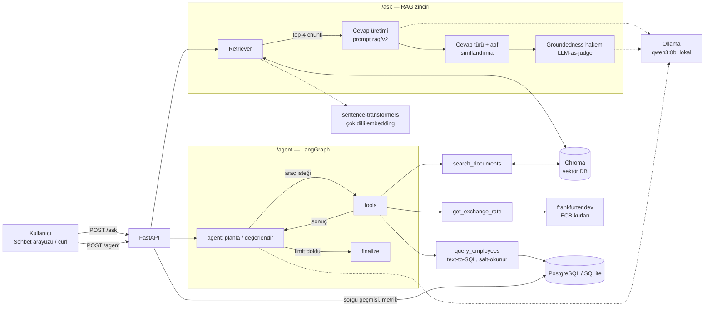

# Kurumsal AI Asistanı


Kurumsal dokümanları (PDF), çalışan veritabanını (SQL) ve dış bir API'yi (döviz kuru) doğal dilde sorgulanabilir hale getiren, **tamamen lokal ve ücretsiz** çalışan bir **RAG + Agent** platformu.

- **`POST /ask` — RAG:** Soruya ilgili doküman parçalarını bulup kaynak göstererek cevap verir; ikinci bir LLM (hakem) cevabın kaynaklara dayandığını doğrular.
- **`POST /agent` — Agent:** Çok adımlı görevlerde araçları (doküman arama, döviz kuru, SQL) sırayla kullanarak sonuca ulaşır. Örnek: *"Yurt dışı harcırahım kaç TL eder?"* → dokümandan 75 € + API'den kur → hesap.
- **Ölçülebilir kalite:** Her istekte süre, token ve maliyet; versiyonlu promptlar; otomatik değerlendirme setleri ve raporlar (`docs/`).

Yol haritası ve alınan tüm kararlar: [PROJE_PLANI.md](PROJE_PLANI.md)

## Mimari



**Ingestion (bir kez):** PDF → sayfalar (`pypdf`) → chunk'lar (1000 karakter / 150 örtüşme) → embedding → Chroma.

## Teknoloji

| Katman | Teknoloji | Not |
| --- | --- | --- |
| API | FastAPI, Pydantic | Dependency injection ile test edilebilir |
| RAG | LangChain (LCEL) | Versiyonlu YAML promptlar |
| Agent | LangGraph | Döngü, adım limiti, adım adım iz; supervisor + worker multi-agent |
| LLM | Ollama · `qwen3:8b` | Lokal, ücretsiz; `.env` ile değiştirilebilir |
| Embedding | `paraphrase-multilingual-MiniLM-L12-v2` | Lokal, Türkçe destekli |
| Vektör DB | Chroma | Gömülü (lokal) veya sunucu (Docker) modu |
| İlişkisel DB | SQLAlchemy · PostgreSQL / SQLite | Sorgu geçmişi + çalışan tablosu |
| Gözlemlenebilirlik | JSON loglar, JSONL ölçüm logları | request_id, süre, token, maliyet |
| Test / CI | pytest (109 test) · GitHub Actions | LLM'siz, sahte modellerle |

## Ölçülmüş sonuçlar

Tüm sayılar bu repodaki scriptlerle üretildi; raporlar `docs/` altında.

**RAG (`/ask`)**

| Ölçüm | Sonuç | Rapor |
| --- | --- | --- |
| Golden set (geliştirmede hiç kullanılmamış 15 soru, elle değerlendirme) | **12/15 tam doğru**, uydurma **0/15** | [golden_set_v1.md](docs/golden_set_v1.md) |
| Geliştirme seti (33 soru, otomatik puanlama), prompt v2 | **30/33** | [prompt_karsilastirma_v2_v3.md](docs/prompt_karsilastirma_v2_v3.md) |
| Retrieval recall@4 (cevaplanabilir sorular) | **16/17** | [prompt_karsilastirma.md](docs/prompt_karsilastirma.md) |
| Groundedness hakemi (22 vaka: 10 doğru, 12 uydurma) | Uydurma yakalama **12/12**, yanlış alarm **0/10** | [groundedness_degerlendirme.md](docs/groundedness_degerlendirme.md) |
| Süre (hakem açık, 29 istek) | p50 **10.5 sn** · p95 **22.1 sn** | `scripts/log_stats.py` |
| Token / maliyet | ~2.400 token/istek · gerçek **$0** · Claude Sonnet 5.5 ile tahmini ~$0.005 | `scripts/log_stats.py` |

**Agent (`/agent`)**

| Ölçüm | Sonuç | Rapor |
| --- | --- | --- |
| Tek adımlı agent (10 görev) | 7/10 — iki araç gerektiren görevlerde 0/3 | [agent_simple.md](docs/agent_simple.md) |
| LangGraph agent, prompt v1 → v2 (12 görev) | 11/12 → **12/12** | [v1](docs/agent_graph_v1.md) · [v2](docs/agent_graph_v2.md) |
| LangGraph agent, SQL görevleri dahil (15 görev) | ⏳ | |
| Supervisor + worker multi-agent (15 görev) | ⏳ | |

**Gelişim:** Faz 1'de `qwen3:1.7b` ile 18 soruda 12 doğru ve 2 uydurma vardı ([faz1_elle_test.md](docs/faz1_elle_test.md)); model (`8b`), kurallı prompt ve hakemle uydurma sıfıra indi.

## Kurulum (lokal)

Gereksinimler: Python 3.12, [uv](https://docs.astral.sh/uv/), [Ollama](https://ollama.com).

```bash
uv sync                          # Bağımlılıklar (uv.lock'taki tam sürümler)
cp .env.example .env             # Ayarlar
ollama pull qwen3:8b             # LLM (~5 GB)
uv run python -m scripts.ingest data/samples/ornek_ik_el_kitabi.pdf   # Dokümanı vektör DB'ye yükle
uv run uvicorn app.api.main:app --reload
```

- Sohbet arayüzü: http://localhost:8000/
- API dokümantasyonu (Swagger): http://localhost:8000/docs

Lokal modda Chroma gömülü (`data/chroma/`), ilişkisel veritabanı SQLite (`data/app.db`) çalışır; ek kurulum gerekmez.

## Kurulum (Docker Compose)

API, PostgreSQL ve Chroma (sunucu modu) konteynerlerde çalışır; **Ollama bilgisayarda kalır** (Mac'te Metal GPU'yu kullanabilmesi için; konteyner `host.docker.internal` ile bağlanır).

```bash
ollama pull qwen3:8b
docker compose up -d --build                     # İlk derleme ~2 dk (CPU-only PyTorch), imaj ~2 GB
docker compose run --rm api python -m scripts.ingest data/samples/ornek_ik_el_kitabi.pdf
# → http://localhost:8000  (Postgres: localhost:5433, Chroma: localhost:8001)
```

| Servis | İmaj | Not |
| --- | --- | --- |
| `api` | `Dockerfile` (python:3.12-slim + uv) | Sağlık kontrolü `/health`; embedding modeli `hf_models` volume'unda |
| `postgres` | `postgres:16-alpine` | `query_logs` + `employees`; veri `pg_data` volume'unda |
| `chroma` | `chromadb/chroma:1.5.9` | Python istemcisiyle aynı sürüm |

Sorgu geçmişine bakmak: `docker compose exec postgres psql -U kurumsal -d kurumsal -c "SELECT endpoint, question, tools_used, total_ms FROM query_logs;"`

## Örnek istekler

**RAG — kaynaklı cevap**

```bash
curl -X POST localhost:8000/ask -H 'Content-Type: application/json' \
  -d '{"question": "Kıdemim 7 yıl, kaç gün yıllık iznim var?"}'
```

```json
{
  "answer": "Kıdeminiz 7 yıl olduğuna göre yıllık izniniz 20 iş günüdür [1].",
  "answer_type": "answered",
  "sources": [{"ref": 1, "source": "ornek_ik_el_kitabi.pdf", "page": 2, "score": 0.3853, "cited": true, "snippet": "4. Yıllık İzin..."}],
  "groundedness": {"grounded": true, "unsupported_claims": []},
  "metrics": {"total_ms": 9412.6, "total_tokens": {"total_tokens": 2949}, "cost": {"usd": 0.0, "reference_model": "claude-sonnet-5-5", "reference_usd": 0.0061}}
}
```

`answer_type`: `answered` (kaynaklı) · `not_found` ("Bu bilgi dokümanlarda yer almıyor.") · `off_topic` · `uncited` (selamlaşma). Hakem desteksiz bir ifade bulursa `grounded: false` ve `unsupported_claims` döner; arayüz uyarı gösterir.

**Agent — çok adımlı görev**

```bash
curl -X POST localhost:8000/agent -H 'Content-Type: application/json' \
  -d '{"question": "Yurt dışı günlük yemek harcırahı ile yurt içi harcırahı TL cinsinden karşılaştır"}'
```

```json
{
  "answer": "Yurt dışı günlük yemek harcırahı 75 Euro [1], güncel kurla (1 EUR = 55,513 TL, 2026-10-27) 4.163,48 TL; yurt içi 1.200 TL [1]. Yurt dışı harcırahı 2.963,48 TL daha yüksek.",
  "steps": [
    {"tool": "search_documents", "args": {"query": "yurt dışı ve yurt içi yemek harcırahı"}},
    {"tool": "get_exchange_rate", "args": {"base": "EUR", "target": "TRY"}}
  ],
  "llm_calls": 3, "stop_reason": "done", "cost_usd": 0.0
}
```

## Yapılandırma (`.env`)

| Değişken | Varsayılan | Açıklama |
| --- | --- | --- |
| `LLM_MODEL` | `qwen3:8b` | Ollama modeli |
| `RAG_PROMPT_VERSION` / `AGENT_PROMPT_VERSION` | `v2` / `v2` | `app/prompts/<ad>/<versiyon>.yaml` |
| `GROUNDEDNESS_CHECK` | `true` | Hakem (kaynaklı cevapların süresini ~2 katına çıkarır) |
| `TOP_K`, `CHUNK_SIZE`, `CHUNK_OVERLAP` | `4`, `1000`, `150` | Retrieval / chunking |
| `AGENT_MAX_STEPS`, `AGENT_MAX_OUTPUT_TOKENS` | `6`, `2048` | Agent döngü ve düşünme sınırları |
| `DATABASE_URL` | `sqlite:///data/app.db` | Docker'da PostgreSQL |
| `CHROMA_HOST` | (boş) | Doluysa Chroma sunucu modu |
| `COST_REFERENCE_MODEL` | `claude-sonnet-5-5` | Yalnızca maliyet *tahmini* için; hiçbir API çağrılmaz |
| `LOG_LEVEL` | `INFO` | JSON loglar stdout'a |

## Değerlendirme ve izleme komutları

```bash
uv run pytest                                              # 109 test (LLM gerektirmez)
uv run python -m scripts.run_golden --min-pass 13          # Golden set kalite kapısı (eşik altı → çıkış kodu 1)
uv run python -m scripts.eval_prompts --versions v1 v2     # RAG prompt karşılaştırması → docs/
uv run python -m scripts.eval_agent --agent graph --out docs/agent.md   # Agent görev seti
uv run python -m scripts.eval_groundedness                 # Hakemin güvenilirliği
uv run python -m scripts.log_stats                         # p50/p95 süre, token, maliyet projeksiyonu
uv run python -m scripts.search "soru"                     # Sadece retrieval
uv run python -m scripts.ask "soru"                        # RAG (komut satırı)
```

## Proje yapısı

```
app/
  api/           FastAPI uygulaması (main.py) ve sohbet arayüzü (static/index.html)
  ingestion/     PDF yükleme (loader), chunking (chunker), Chroma'ya yazma (pipeline)
  retrieval/     Arama (retriever), RAG zinciri (rag), bağlam (context), atıflar (citations), hakem (groundedness)
  agent/         Araçlar (tools, sql_tool), tek adımlı agent, LangGraph agent (graph), multi-agent
  prompts/       Versiyonlu promptlar: rag/, agent/, supervisor/, groundedness/
  evaluation/    Kural tabanlı puanlama
  db.py          SQLAlchemy modelleri (query_logs, employees)
  observability.py, cost.py, pricing.yaml, logging_config.py   Ölçüm, maliyet, JSON log
  config.py, llm.py, embeddings.py, vectorstore.py             Ayarlar ve bağlantılar
data/samples/    Kurgusal örnek PDF (çalışan el kitabı)
data/eval/       Değerlendirme setleri: questions, golden_set, groundedness, agent_tasks
docs/            Ölçüm raporları
scripts/         Ingest, arama, değerlendirme ve istatistik betikleri
tests/           pytest (sahte LLM/embedding ile)
```

## Bilinen sınırlar

- **Hız:** Lokal 8B model; RAG ~10–20 sn, çok adımlı agent görevleri 1–3 dk sürer (agent düşünme modunda çalışır — qwen3 düşünme kapalıyken araç çağıramıyor).
- **Retrieval:** "Standart çalışma saatleri" sorusunda doğru chunk ilk 4'e girmiyor; reranking / daha küçük chunk ile iyileştirilebilir.
- **Türkçe ve atıf:** 8B model ara sıra dil bilgisi hatası ve yanlış atıf numarası üretiyor; hakem atıf numaralarını kontrol etmiyor.
- **Örnek veri kurgusal:** Doküman ve çalışan verisi test amaçlıdır.
